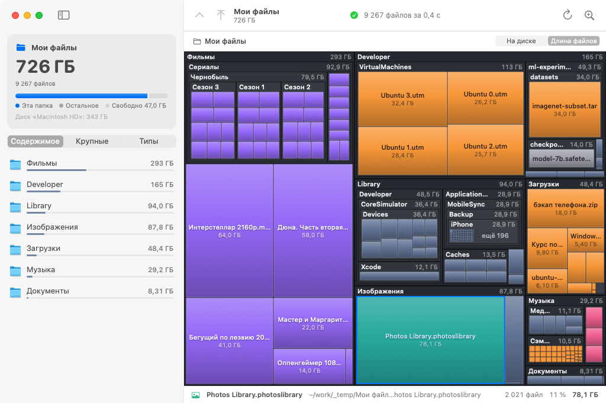
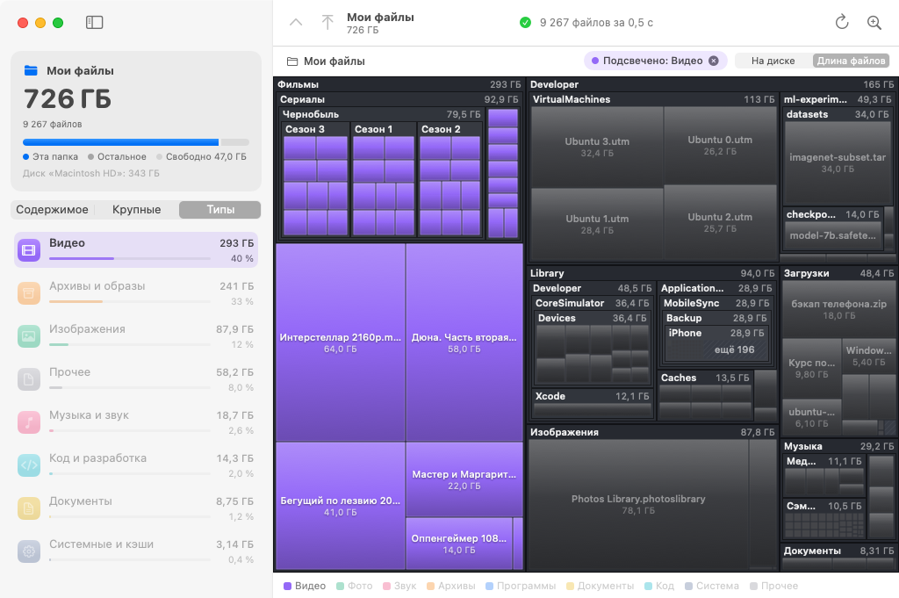

<div align="center">


# SpaceMap

**Посмотри, что съело место на диске Mac: одна большая карта, по которой можно ходить.**

[](https://github.com/renkagod/spacemap/actions/workflows/build.yml)
[](https://github.com/renkagod/spacemap/releases/latest)


[](LICENSE)

[**Скачать**](https://github.com/renkagod/spacemap/releases/latest/download/SpaceMap-macOS.zip) · Apple Silicon и Intel · 1 МБ

</div>



Чем больше прямоугольник, тем больше места занимает файл или папка. Папки вложены друг в друга
с заголовками и размерами, цвет показывает тип файлов. Карта строится прямо во время
сканирования, ждать конца не нужно.

## Возможности

- Папки нарисованы рамками, файлы плитками, а то, что слишком мелко для карты, собрано в блок «ещё N».
- Сканирование идёт на всех ядрах (`readdir` + `lstat`). Размеры считаются как у `du`: занятые
  блоки, жёсткие ссылки один раз, симлинки и другие диски не учитываются.
- Двойной клик или щипок открывает папку; Esc, ⌘↑, боковая кнопка мыши или свайп возвращают
  наверх, с анимацией.
- В боковой панели содержимое текущей папки, самые крупные файлы в ней и разбивка по типам.
- Клик по «Видео» в легенде или во вкладке «Типы» гасит на карте всё остальное.
- По правому клику можно открыть файл, показать в Finder, скопировать путь, пересканировать
  папку или переместить в Корзину.
- Размер считается либо как занятое на диске место, либо как сумма длин файлов, как в Finder.
- Приложения, медиатека «Фото», проекты Logic и другие пакеты показаны одним блоком, как в Finder.
- Папку можно перетащить в окно или на иконку в Dock.

<table>
  <tr>
    <td></td>
    <td></td>
  </tr>
  <tr>
    <td align="center">Разбивка по типам и подсветка видео</td>
    <td align="center">Самые крупные файлы</td>
  </tr>
</table>

## Установка

1. Скачай [`SpaceMap-macOS.zip`](https://github.com/renkagod/spacemap/releases/latest/download/SpaceMap-macOS.zip)
   со страницы [релизов](https://github.com/renkagod/spacemap/releases), распакуй и перетащи
   `SpaceMap.app` в «Программы».
2. Приложение не подписано сертификатом Apple, поэтому при первом запуске macOS его заблокирует.
   Открой Системные настройки → Конфиденциальность и безопасность и нажми «Всё равно открыть».
   Или выполни в Терминале:

   ```bash
   xattr -cr /Applications/SpaceMap.app
   ```

3. Чтобы видеть весь диск, включая почту, «Сообщения» и системные папки, дай SpaceMap
   «Полный доступ к диску» в тех же настройках. Без него приложение тоже работает, просто
   покажет такие папки недоступными.

Нужна macOS 13 Ventura или новее.

## Сборка из исходников

Нужен Swift 5.9+: Xcode или Command Line Tools (`xcode-select --install`).

```bash
git clone https://github.com/renkagod/spacemap.git
cd spacemap
bash scripts/build-app.sh
open build/SpaceMap.app
```

С полным Xcode получится универсальный бинарник arm64 + x86_64, с одними Command Line Tools
сборка будет только под твой Mac. Рядом появится `build/SpaceMap-macOS.zip`, такой же, как в релизе.

Тесты: `swift test`.

## Как устроено

| Где | Что |
|---|---|
| [`Sources/SpaceMapCore/DiskScanner.swift`](Sources/SpaceMapCore/DiskScanner.swift) | Многопоточный обход: дерево растёт под одной блокировкой, интерфейс читает его на лету |
| [`Sources/SpaceMapCore/Treemap.swift`](Sources/SpaceMapCore/Treemap.swift) | Squarified treemap (Bruls, Huizing, van Wijk) с вложенными папками и склейкой мелочи |
| [`Sources/SpaceMap/TreemapRenderer.swift`](Sources/SpaceMap/TreemapRenderer.swift) | Отрисовка в битмап на Core Graphics и Core Text в фоновом потоке |
| [`Sources/SpaceMap/TreemapView.swift`](Sources/SpaceMap/TreemapView.swift) | NSView: наведение, клики, меню, жесты и анимация зума |
| [`Sources/SpaceMap/*View.swift`](Sources/SpaceMap) | Интерфейс на SwiftUI |

Зависимостей нет, только системные фреймворки.

Новая версия выходит так: `git tag v1.2.3 && git push origin v1.2.3`. CI прогонит тесты, соберёт
приложение и выложит zip в релиз.

## Участие

Баги и идеи пиши в [issues](https://github.com/renkagod/spacemap/issues). Пулл-реквесты
приветствуются: перед отправкой проверь, что проходят `swift test` и `bash scripts/build-app.sh`.

## Лицензия

[MIT](LICENSE)
