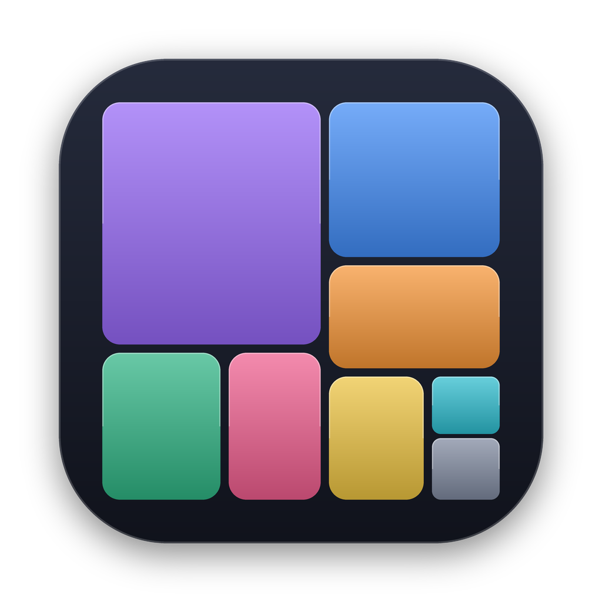
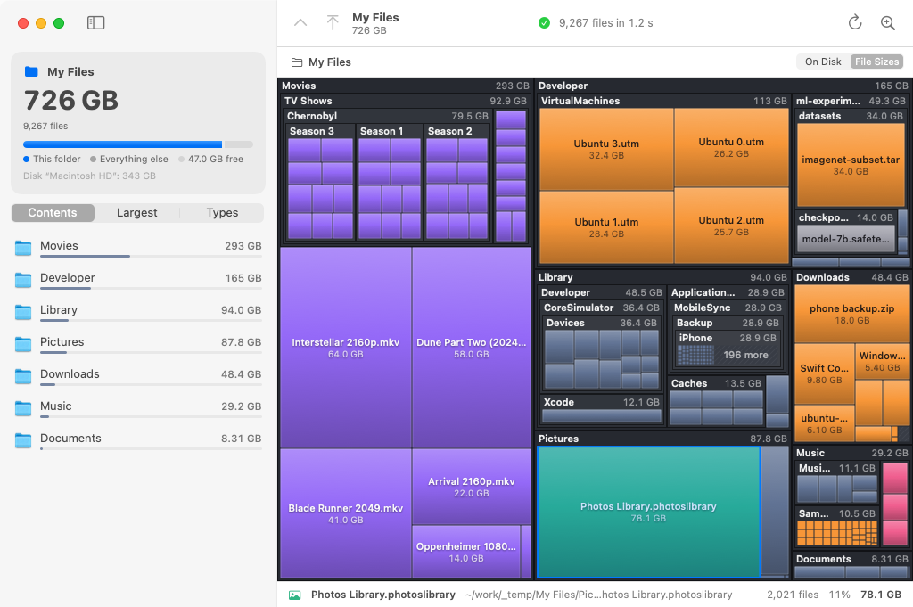
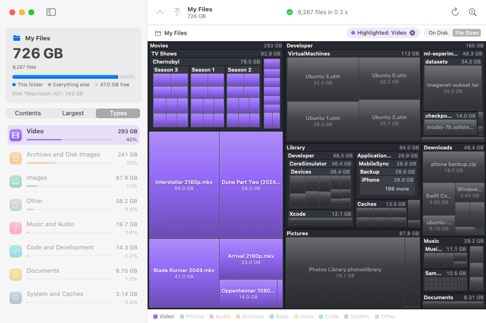
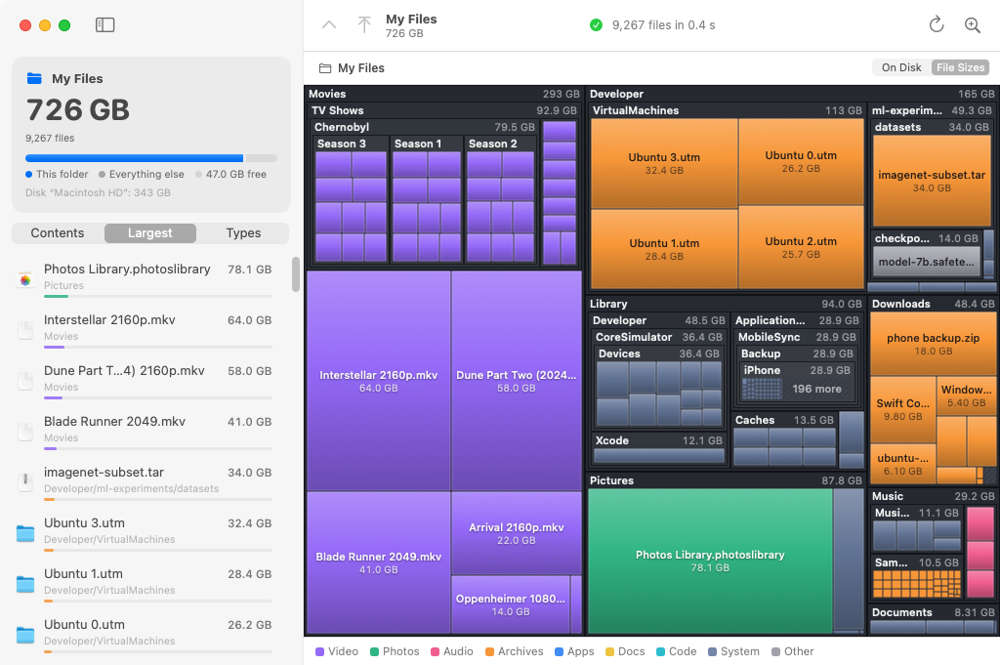
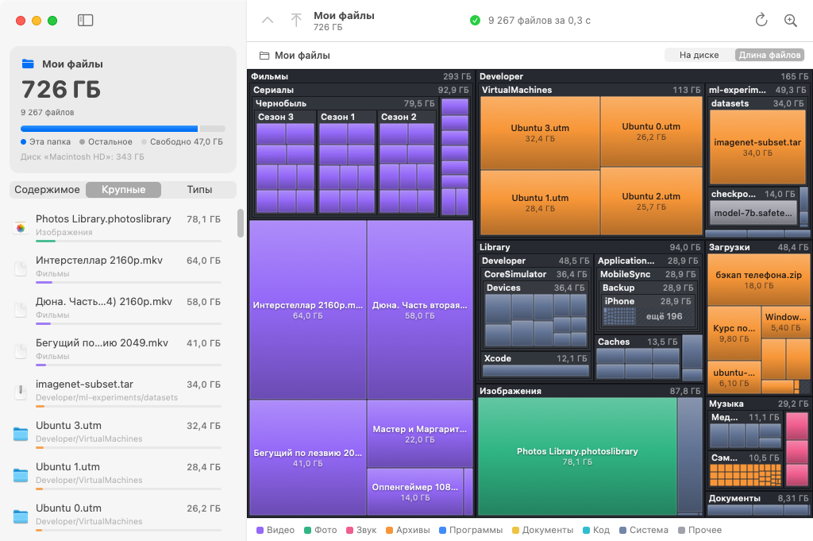

<div align="center">



# SpaceMap

See what is eating your Mac's disk, as one big map you can walk through.<br>
Посмотри, что съело место на диске Mac: одна большая карта, по которой можно ходить.

[](https://github.com/renkagod/spacemap/actions/workflows/build.yml)
[](https://github.com/renkagod/spacemap/releases/latest)


[](LICENSE)

<a href="#english"></a>
&nbsp;&nbsp;
<a href="#%D1%80%D1%83%D1%81%D1%81%D0%BA%D0%B8%D0%B9"></a>

</div>

## English

<p align="center">
<a href="#english"></a>
<a href="#%D1%80%D1%83%D1%81%D1%81%D0%BA%D0%B8%D0%B9"></a>
</p>

[**Download**](https://github.com/renkagod/spacemap/releases/latest/download/SpaceMap-macOS.zip) · Apple Silicon and Intel · 1 MB



The bigger the rectangle, the more space the file or folder takes. Folders nest inside each other
with their names and sizes, and the color shows the file type. The map fills in while the scan
runs, so you don't have to wait for it to finish.

### Features

- Folders are drawn as frames and files as tiles. Whatever is too small to draw is gathered into
  an "N more" block.
- The scan runs on all cores (`readdir` + `lstat`). Sizes match `du`: allocated blocks, hard links
  counted once, symlinks and other volumes skipped.
- Double-click or pinch to open a folder. Esc, ⌘↑, the mouse back button or a swipe goes back up,
  with an animation.
- The sidebar shows what the current folder holds, its largest files and a breakdown by type.
- Click "Video" in the legend or on the Types tab and everything else on the map dims.
- Right-click to open a file, show it in Finder, copy its path, rescan a folder or move it to the
  Trash.
- Sizes can be counted as space taken on disk or as the sum of file lengths, the way Finder does.
- Apps, the Photos library, Logic projects and other packages show up as one block, like in Finder.
- Drop a folder onto the window or onto the Dock icon to scan it.
- The interface is in English and Russian and follows the system language. SpaceMap → Language
  switches it, and new languages can be added without rebuilding the app
  ([how to translate](TRANSLATING.md)).

<table>
  <tr>
    <td></td>
    <td></td>
  </tr>
  <tr>
    <td align="center">Breakdown by type, videos highlighted</td>
    <td align="center">Largest files</td>
  </tr>
</table>

### Install

1. Download [`SpaceMap-macOS.zip`](https://github.com/renkagod/spacemap/releases/latest/download/SpaceMap-macOS.zip)
   from [Releases](https://github.com/renkagod/spacemap/releases), unzip it and drag `SpaceMap.app`
   into Applications.
2. The app is not signed with an Apple certificate, so macOS blocks the first launch. Open
   System Settings → Privacy & Security and click "Open Anyway". Or run this in Terminal:

   ```bash
   xattr -cr /Applications/SpaceMap.app
   ```

3. To see the whole disk, including Mail, Messages and system folders, give SpaceMap Full Disk
   Access in the same settings. Without it the app still works and shows those folders as
   inaccessible.

Requires macOS 13 Ventura or later.

### Build from source

You need Swift 5.9 or later: Xcode or the Command Line Tools (`xcode-select --install`).

```bash
git clone https://github.com/renkagod/spacemap.git
cd spacemap
bash scripts/build-app.sh
open build/SpaceMap.app
```

With full Xcode you get a universal arm64 + x86_64 binary, with the Command Line Tools alone a
build for your Mac only. `build/SpaceMap-macOS.zip` appears next to it, the same archive as in a
release.

Tests: `swift test`.

### How it works

| Where | What |
|---|---|
| [`Sources/SpaceMapCore/DiskScanner.swift`](Sources/SpaceMapCore/DiskScanner.swift) | Multithreaded walk: the tree grows under one lock and the interface reads it live |
| [`Sources/SpaceMapCore/Treemap.swift`](Sources/SpaceMapCore/Treemap.swift) | Squarified treemap (Bruls, Huizing, van Wijk) with nested folders and merging of small entries |
| [`Sources/SpaceMapCore/Localization.swift`](Sources/SpaceMapCore/Localization.swift) | Loads the interface text from [`Resources/Translations`](Resources/Translations) and the user's translations folder |
| [`Sources/SpaceMap/TreemapRenderer.swift`](Sources/SpaceMap/TreemapRenderer.swift) | Draws into a bitmap with Core Graphics and Core Text on a background thread |
| [`Sources/SpaceMap/TreemapView.swift`](Sources/SpaceMap/TreemapView.swift) | NSView: hover, clicks, menus, gestures and the zoom animation |
| [`Sources/SpaceMap/*View.swift`](Sources/SpaceMap) | SwiftUI interface |

No dependencies, only system frameworks.

A release is `git tag v1.2.3 && git push origin v1.2.3`. CI runs the tests, builds the app and
attaches the zip to the release.

### Contributing

Report bugs and ideas in [issues](https://github.com/renkagod/spacemap/issues). Pull requests are
welcome; check that `swift test` and `bash scripts/build-app.sh` pass before sending one.
Translations into new languages are welcome too, see [TRANSLATING.md](TRANSLATING.md).

### License

[MIT](LICENSE)

## Русский

<p align="center">
<a href="#english"></a>
<a href="#%D1%80%D1%83%D1%81%D1%81%D0%BA%D0%B8%D0%B9"></a>
</p>

[**Скачать**](https://github.com/renkagod/spacemap/releases/latest/download/SpaceMap-macOS.zip) · Apple Silicon и Intel · 1 МБ


Чем больше прямоугольник, тем больше места занимает файл или папка. Папки вложены друг в друга
с заголовками и размерами, цвет показывает тип файлов. Карта строится прямо во время
сканирования, ждать конца не нужно.

### Возможности

- Папки нарисованы рамками, файлы плитками, а то, что слишком мелко для карты, собрано в блок «ещё N».
- Сканирование идёт на всех ядрах (`readdir` + `lstat`). Размеры считаются как у `du`: занятые
  блоки, жёсткие ссылки один раз, симлинки и другие диски не учитываются.
- Двойной клик или щипок открывает папку; Esc, ⌘↑, боковая кнопка мыши или свайп возвращают
  наверх, с анимацией.
- В боковой панели содержимое текущей папки, самые крупные файлы в ней и разбивка по типам.
- Клик по «Видео» в легенде или во вкладке «Типы» гасит на карте всё остальное.
- По правому клику можно открыть файл, показать в Finder, скопировать путь, пересканировать
  папку или переместить в Корзину.
- Размер считается либо как занятое на диске место, либо как сумма длин файлов, как в Finder.
- Приложения, медиатека «Фото», проекты Logic и другие пакеты показаны одним блоком, как в Finder.
- Папку можно перетащить в окно или на иконку в Dock.
- Интерфейс на русском и английском, язык берётся из системы. Сменить его можно в меню
  SpaceMap → Язык, а новый язык добавляется без пересборки ([как перевести](TRANSLATING.md#%D1%80%D1%83%D1%81%D1%81%D0%BA%D0%B8%D0%B9)).

<table>
  <tr>
    <td></td>
    <td></td>
  </tr>
  <tr>
    <td align="center">Разбивка по типам и подсветка видео</td>
    <td align="center">Самые крупные файлы</td>
  </tr>
</table>

### Установка

1. Скачай [`SpaceMap-macOS.zip`](https://github.com/renkagod/spacemap/releases/latest/download/SpaceMap-macOS.zip)
   со страницы [релизов](https://github.com/renkagod/spacemap/releases), распакуй и перетащи
   `SpaceMap.app` в «Программы».
2. Приложение не подписано сертификатом Apple, поэтому при первом запуске macOS его заблокирует.
   Открой Системные настройки → Конфиденциальность и безопасность и нажми «Всё равно открыть».
   Или выполни в Терминале:

   ```bash
   xattr -cr /Applications/SpaceMap.app
   ```

3. Чтобы видеть весь диск, включая почту, «Сообщения» и системные папки, дай SpaceMap
   «Полный доступ к диску» в тех же настройках. Без него приложение тоже работает, просто
   покажет такие папки недоступными.

Нужна macOS 13 Ventura или новее.

### Сборка из исходников

Нужен Swift 5.9+: Xcode или Command Line Tools (`xcode-select --install`).

```bash
git clone https://github.com/renkagod/spacemap.git
cd spacemap
bash scripts/build-app.sh
open build/SpaceMap.app
```

С полным Xcode получится универсальный бинарник arm64 + x86_64, с одними Command Line Tools
сборка будет только под твой Mac. Рядом появится `build/SpaceMap-macOS.zip`, такой же, как в релизе.

Тесты: `swift test`.

### Как устроено

| Где | Что |
|---|---|
| [`Sources/SpaceMapCore/DiskScanner.swift`](Sources/SpaceMapCore/DiskScanner.swift) | Многопоточный обход: дерево растёт под одной блокировкой, интерфейс читает его на лету |
| [`Sources/SpaceMapCore/Treemap.swift`](Sources/SpaceMapCore/Treemap.swift) | Squarified treemap (Bruls, Huizing, van Wijk) с вложенными папками и склейкой мелочи |
| [`Sources/SpaceMapCore/Localization.swift`](Sources/SpaceMapCore/Localization.swift) | Загружает тексты интерфейса из [`Resources/Translations`](Resources/Translations) и папки переводов пользователя |
| [`Sources/SpaceMap/TreemapRenderer.swift`](Sources/SpaceMap/TreemapRenderer.swift) | Отрисовка в битмап на Core Graphics и Core Text в фоновом потоке |
| [`Sources/SpaceMap/TreemapView.swift`](Sources/SpaceMap/TreemapView.swift) | NSView: наведение, клики, меню, жесты и анимация зума |
| [`Sources/SpaceMap/*View.swift`](Sources/SpaceMap) | Интерфейс на SwiftUI |

Зависимостей нет, только системные фреймворки.

Новая версия выходит так: `git tag v1.2.3 && git push origin v1.2.3`. CI прогонит тесты, соберёт
приложение и выложит zip в релиз.

### Участие

Баги и идеи пиши в [issues](https://github.com/renkagod/spacemap/issues). Пулл-реквесты
приветствуются: перед отправкой проверь, что проходят `swift test` и `bash scripts/build-app.sh`.
Переводы на другие языки тоже, инструкция в [TRANSLATING.md](TRANSLATING.md#%D1%80%D1%83%D1%81%D1%81%D0%BA%D0%B8%D0%B9).

### Лицензия

[MIT](LICENSE)
